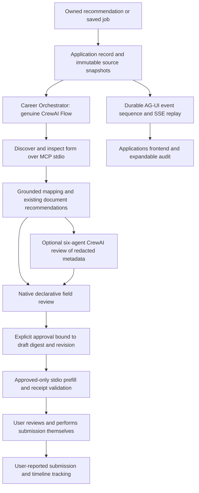

# Application Preparation and Tracking milestone

The Applications workspace prepares a job-specific application from confirmed profile facts, records field and attachment review, sends only the approved snapshot to a controlled MCP stdio adapter, and maintains a private application timeline. It never submits an application externally.

The current 10,000-job provider contains synthetic listings whose URLs use `example.invalid`. Consequently the built-in application adapter is a **local demo**, clearly labelled throughout the interface, receipts, submission acknowledgement and tracking record. A provider-agnostic operator-configured stdio adapter is an extension point; a real job-site/browser adapter was not supplied or tested. There is no claim of universal website automation.

For the current recovery, mapping, tracking and mock-scenario extensions, see [the continuation report](application-recovery-continuation.md). Verification numbers below describe the initial milestone.

## Reference patterns reused

Only the relevant Velion integration, form, transaction, event and MCP App modules were inspected, at commit `bddc8ec0256d512496088e349900262255037d8b`. References:

- `backend/app/integrations/mcp_stdio.py`: lazy SDK, bounded session, stdio child ownership, worker-thread wrapper when an event loop already exists.
- `backend/app/forms/mcp_form_provider.py` and `backend/app/transactions/mcp_providers.py`: typed form metadata and distinct validation rejection/provider failure.
- `backend/app/api/v1/endpoints/mcp_apps.py`: registered resources and tools, with state-changing actions routed through the canonical orchestrator.
- `backend/app/schemas/agui.py` and `frontend/src/services/agui/aguiTransport.ts`: run/tool/state events, ordered sequences and SSE parsing.
- `backend/app/schemas/workflow.py`: declarative surfaces, component registry and server-supported actions.
- `frontend/src/components/velion/mcp/McpAppFrame.tsx`, `frontend/src/mcp-apps/runtime.ts`, and `frontend/scripts/build-mcp-apps.mjs`: real MCP Apps resource fetching, official SDK handshake and bundled offline UI.

No booking/payment business logic, assets, service keys or transaction data was copied. The official [MCP Apps overview](https://modelcontextprotocol.io/extensions/apps/overview) documents the tool-to-resource binding, HTML resource, sandbox and bidirectional host bridge used here.

## Architecture



The six local evidence/safety stages are explicit CrewAI Flow tasks, with execution IDs, actual methods and elapsed times. They are labelled **deterministic CrewAI Flow tasks**, not falsely described as model calls. The optional Crew contains six genuine `crewai.Agent` objects and six typed `crewai.Task` outputs:

| Agent | Responsibility / bounded output |
| --- | --- |
| Application Preparation | Review safe, confirmation-required and unavailable classifications. |
| Application Form Mapping | Flag ambiguous semantic/type mappings. |
| Document Selection | Recommend only supplied confirmed resume IDs. |
| MCP Application Interaction | Review discovered capabilities; actual inspection/prefill remains behind deterministic approval gates. |
| Application Tracking | Review job identity, duplicate protection and lifecycle boundaries. |
| Application Validation | Independently flag unsupported IDs or unsafe assumptions. |

All use structured `AgentReview` outputs. Agents may request more review or recommend an existing document ID. They cannot add candidate values, promote a sensitive value, approve a field, attach a file, change a profile, submit, or write tracking state. Grounding is independently rechecked before draft publication. Actual MCP actions are carried out by the orchestrator's interaction stage; LLMs do not get a general browser tool.

Optional AI exports **field IDs, types, required/sensitive flags, classifications, confirmed document IDs and discovered tool names**. Candidate names, contact details, field values, resume text, filenames, job/employer text and files are excluded. Explicit consent is required. Missing keys, timeouts or invalid agent references retain the grounded local draft, with an unavailable-review warning. The live synthetic test completed all six agents; their concerns were retained as `needs_review`, rather than being represented as automatic approval.

## State and approval model

The normal path is:

`job_selected → preparing → draft_ready → needs_user_review → approved_for_prefill → prefilling → prefill_complete → needs_submission_approval → submitted_by_user → tracking_active → interview → offer → accepted/rejected/withdrawn/closed`.

`draft_ready` and every transition are durable timeline events even when the next review state is published in the same transaction. Failure and cancellation are explicit states. Rejection/withdrawal/closure are allowed from appropriate tracking states; accepting requires an offer. A recorded interview can move active tracking into `interview`; multiple interview-stage events preserve history.

- All mutations require the current `expected_revision` and use SQL compare-and-swap updates.
- One application per owner/job/source identity (with legacy-job compatibility checks) prevents duplicate records; an already-created record is opened from the tracker.
- Editing fields or attachments before prefill resets approval. Completed/uncertain prefills cannot be edited; use the controlled recovery or fresh-preparation path.
- A profile revision or confirmed-fact hash change marks the application stale and blocks new approvals/prefill until a new preparation.
- Every populated field must be reviewed; required inputs must be present and typed correctly. Partial drafts can be saved without being eligible for prefill.
- Approval binds the exact draft, job identity, provider and confirmed-source hash. An explicit second action starts prefill.
- Only individually approved nonempty values and explicitly approved selected files enter the packet. Checkbox `false` remains a real explicit value.
- The packet includes form ID/version, operation ID, job ID and approved/profile revisions. Receipts must echo the packet digest, job/operation IDs, exact applied field IDs and attached document hashes, and must state `submitted=false`.
- There is **no submit tool**, iframe route or backend action that submits to a job site. `record_submission` only records the user's explicit acknowledgement, marked `user_reported`; the demo acknowledgement explicitly records a simulation.
- A failed or interrupted prefill can have an unknown remote outcome. It is never automatically retried: reconcile its receipt first. Only known partial work permits an explicit retry of unfinished actions; see the continuation report.
- Cancellation prevents late worker publication; it does not claim to undo any already-performed remote prefill. Startup recovery preserves history and marks interrupted operations failed.

## Field and document evidence

The mapper uses controlled semantic/name aliases across each provider's typed schema. It supports text, email, telephone, textarea, select, radio, checkbox, date, file and multi-select fields. Options and types are validated; incompatible values remain unavailable. It does not split names into culturally ambiguous first/last names, invent an address granularity, or choose an arbitrary portfolio link.

Directly supported values carry their `confirmed_profile.<field>` source, copied evidence value, confidence label and classification. Complex education, experience and project values preserve the confirmed structures as text rather than generating unsupported prose. Application-only user corrections are labelled `user_input` and never added to the confirmed profile. Sensitive legal/demographic fields, salary, availability and consent need explicit input; misleading provider semantics cannot make the mapper infer them.

Document choices are existing private uploads. Confirmed resume-source IDs come from verification receipts; no file is automatically attached. The selected file record binds document ID, role, selected job, original SHA-256 and explicit approval. Ownership, existence, hash and resume confirmation are checked again before transfer. Total selected attachment bytes are bounded to 5 MiB. A deleted/unavailable document requires renewed review. Existing documents may be selected as cover letters or supporting files after user review; no new resume or cover letter generation is introduced. DOCX reading/rendering continues through the existing direct reader and strictly headless LibreOffice converter.

## MCP, A2UI and AG-UI

The Python MCP SDK is pinned explicitly. Each session initializes a real stdio transport, discovers tools and then calls an allowed tool or reads `ui://ascendra/application`. The demo advertises `inspect_application` with `_meta.ui.resourceUri` plus `prefill_application`, `open_application` and read-only `application_status`. Its HTML is returned as `text/html;profile=mcp-app` over `resources/read`.

`APPLICATION_MCP_COMMAND` is an **operator-owned JSON argv array**, never a request parameter. The browser cannot select a module, executable, arbitrary resource or arbitrary tool. The default command is the built-in demo. Backend credential/database/session environment variables are not inherited by adapters. A small owned launcher watches the requesting worker, while the SDK bounds session time and tears down its own process tree; no unrelated processes are terminated.

The official MCP Apps `AppBridge`, `App` and `PostMessageTransport` implement the real iframe handshake and `tools/call` relay. The self-contained resource is built from frontend source and included in the backend so Python runtime needs no Node bundler. The iframe has an opaque origin with `sandbox="allow-scripts"`, no native forms, network connections, popups or host navigation permission. Host CSP disables external resources. DOM text APIs render values, avoiding HTML interpolation. Local saves use an explicit button/tool call; a native `<form>` would be blocked by this deliberately strict sandbox.

The iframe allowlist contains only `application_state` and `review_application`; both go through ownership checks and the canonical host service. Approve/prefill/submission acknowledgement remain host controls. Configured-provider iframe state masks unapproved values and is only opened after approved prefill. If MCP UI loading fails, the native local review interface remains available.

The `/surface` response contains a **documented A2UI 0.8 interaction subset**, not a claim of a complete A2UI renderer/catalog: surface updates, bound data-model updates and begin-rendering messages, with an allowlisted native typed form. Text/date/choice/checkbox components are represented; document selection remains a host control. The resource renders the same server-defined schema using the MCP Apps SDK.

AG-UI patterns follow Velion's event vocabulary: `RUN_STARTED`, `RUN_FINISHED`, `RUN_ERROR`, `AGENT_STATE`, `STATE_SNAPSHOT`, `FORM_OPEN`, `FORM_SUBMITTED`, `TOOL_CALL_START/END`, `TRANSACTION_STATE`. Events have durable monotonically increasing sequence numbers. The authenticated fetch/SSE client resumes with `after`, suppresses duplicates, refreshes canonical state and retains a manual refresh path. SSE does not expose profile field values. It is an interaction-pattern integration, not a replacement for CrewAI or a claim of full AG-UI SDK conformance.

## Persistence and API

The initial milestone added `applications` and `application_events`; the continuation adds ten typed detail/history tables. Existing tables and data are preserved. Records include owned source/job snapshots, revision/hash, status/stage, typed draft, approval, validated receipt, task metadata and timestamps. Notes, interviews, deadlines, follow-ups, user-reported references and status changes live in the sequenced timeline. This prototype uses the existing bounded local worker infrastructure, capacity four and two application worker threads, and is intended for a single loopback application process.

All endpoints are under `/api/v1/applications`, with the existing HttpOnly session, local-client header, ownership and safe-error rules:

| Method | Route | Purpose |
| --- | --- | --- |
| GET | `/readiness` | Confirmation prerequisites, provider choices and available documents. |
| POST / GET | `` | Select an owned recommended/saved job; list/filter/page applications. |
| GET | `/{id}` | Current canonical state, staleness and allowed actions. |
| POST | `/{id}/actions` | Prepare/retry, review, approve prefill, prefill, continue to manual submission, acknowledge submission, activate tracking or cancel. |
| POST | `/{id}/tracking` | Note, deadline, follow-up, interview stage or allowed outcome transition. |
| GET | `/{id}/timeline` | Ordered private events; optional sequence cursor. |
| GET | `/{id}/events` | Authenticated SSE live/replay; `follow=false` for finite replay. |
| GET | `/{id}/surface` | Typed declarative form and A2UI messages. |
| GET | `/{id}/mcp/resource` | HTML fetched through the real MCP protocol. |
| GET | `/{id}/mcp/tools` | Real discovered capabilities and the separate host allowlist. |
| POST | `/{id}/mcp/call` | Only local state/review requests from the iframe. |

The UI supports job-specific links from recommendations, saved-job selection, paginated status views, evidence per field, partial review saves, document roles, explicit approvals, stale/error/cancel/retry states, timeline scheduling, interview/outcome recording, a clean native interface and expandable source/agent/MCP audit. The dashboard now reads actual pending approvals and status counts.

## Reproduction and verification

1. Start the existing backend and frontend. Open `/applications` after confirming profile facts.
2. Save an opportunity, or follow **Prepare application for this job** from a recommendation.
3. Create the record, then choose **Prepare application**. Inspect source values and missing manual inputs.
4. Enter required information; review every populated value and explicitly select any documents. Save the review.
5. Approve the exact prefill snapshot and start the MCP prefill. Confirm that the receipt says no submission occurred.
6. Review the prefilled form. For the current local demo, explicitly acknowledge **demo completion**, then activate tracking.
7. Record notes, deadlines, follow-ups, interview stages and valid outcome transitions. Inspect the sequenced audit/events.

Automated checks and their actual outcomes are recorded in `application-verification.json`. Synthetic API and live-model smoke receipts are in `application-api-smoke.json` and `application-live-smoke.json`. Reproduce:

- Full backend regression: **438 passed**; final application suite: **51 passed**, including an additional contradictory-schema guard added after the full run.
- Full Chromium regression with the patched SDK: **46 passed**, including five application browser scenarios and the actual iframe bridge.
- TypeScript and production build passed. ESLint: zero errors and ten existing Fast Refresh warnings. Python compilation, formatting and both repository diff checks passed.
- Real spawned API/stdio lifecycle: **5.3663 seconds**, 17 fields, 21 sequential events, SSE replay HTTP 200, confirmed profile unchanged and `submitted_by_provider=false`.
- Real six-agent Groq/CrewAI/stdio preparation: **10.1249 seconds**, all six model tasks completed; review concerns retained, zero automatically approved fields and zero automatically attached documents. No private profile database was loaded.
- Main database: all original rows across **15 tables unchanged**; only the two new empty application tables added. The private backup was created before refresh. The seeded fixture SHA-256 is unchanged.
- The reference MCP JavaScript SDK version had a reported advisory. The new integration uses patched **1.32.1**, with zero MCP-package advisories in the final production audit. Nine pre-existing framework dependency advisories remain (four high, five critical); their unrelated framework migration is outside this feature's scope. Keep the existing loopback-only deployment model.

```sh
.venv/bin/python -m pytest tests/test_applications.py
.venv/bin/python -m scripts.smoke_applications --output /tmp/application-api-smoke.json
# Optional real Groq requests; synthetic metadata only, no private database loaded:
.venv/bin/python -m scripts.smoke_applications --live --output /tmp/application-live-smoke.json
```

Frontend: `npm run build:application-app`, `npm run typecheck`, `npm run lint`, `npm run build`, and Playwright `tests/e2e/applications.spec.ts`. Browser tests use an isolated temporary backend/database and exercise the real SDK iframe bridge, source corrections, strict approval boundaries, stdio prefill, user-reported demo completion, interviews/outcomes, mobile layout, provider/UI failure, duplicate protection and retry. Existing frontend/backend regressions are also run.

## Limits and next extensions

- Real external job-site navigation, login, CAPTCHA, file widgets and final submission are not universally automated. A trusted operator adapter must implement the documented inspection/prefill/receipt contract for an actual source. It must not submit.
- Tracking is user-maintained; employer submission/interview/offer claims are not independently verified. No email, calendar, payment or notification integration is implied.
- No document generation/tailoring, account recovery, production authentication, distributed queue, encryption-at-rest or general browser execution was introduced.
- Heuristic confidence labels describe evidence/mapping confidence, not factual or hiring probabilities. Unknown required fields remain manual; missing skill evidence does not prove inability.
- The controlled synthetic evaluation and Chromium tests establish these contracts; they are not broad real-employer form-coverage benchmarks.
- Existing unrelated dependency advisories are reported separately in verification. Dependency upgrades were limited to the MCP integration introduced by this milestone.
