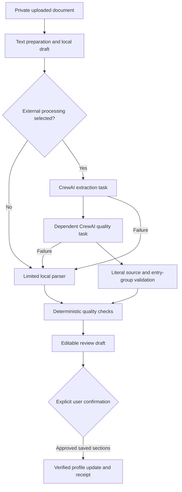

# Resume Intelligence Crew and seeded jobs

Historical text-first checkpoint. Current OCR, visual-task and audit implementation: [multimodal Resume Intelligence](multimodal-resume-intelligence.md).
The subsequent [1,000-job dataset milestone](seeded-jobs-dataset.md) supersedes the original ten-job provider details below.

19 October 2026. Local implementation in the existing backend and frontend. No deployment, commit, push, public authentication, external job integration, matching, or application automation is included.

## Reused foundation

The pre-change suites passed: 91 backend tests and 17 Playwright cases. Existing private SQL document storage, bounded PDF/DOCX/TXT text preparation, heading aliases, entry grouping, source receipts, draft edits, confirmation/rejection/cancellation/reprocessing, profile revision checks, individual skill editing and dashboard queries are reused. Verified profiles are never automatically reprocessed or rewritten.

## Actual agent architecture

The production worker imports `app.orchestration.resume.enhance`, which starts a real `crewai.Crew`. `crewai==1.15.28` is pinned alongside the existing dependency versions. This is framework execution, not a class merely named “agent.”

| Layer | Implementation | Responsibility |
| --- | --- | --- |
| Preparation | `services/resume_text.py`, `resume_structure.py` | Read document text, retain source positions/limitations, identify conservative sections and entry groups. |
| Agents | `agents/resume.py` | Real Resume Intelligence Agent and Resume Quality Validator, using a custom CrewAI `BaseLLM`. |
| Tasks | `tasks/resume.py` | Strict extraction task followed by quality audit with explicit `context=[extraction]`. |
| Crew | `crews/resume.py` | Actual two-agent/two-task `Crew`, `Process.sequential`. |
| Schemas | `schemas/agents.py`, `schemas/extraction.py` | Typed preparation input, `ProviderResume`, quality issues/report and composed result. |
| Provider | `providers/groq.py` | Shared rotating-key transport, strict provider schema and bounded HTTP requests. |
| Orchestration | `orchestration/resume.py` | Spawn/stop isolated crew, deadlines, cancellation checks, safe errors and source anchoring. |
| Publication | `services/document_processing.py` | Run local validation, store an unverified draft and actual execution metadata. |
| Confirmation | Existing `services/extraction_review.py` | Explicit revision-checked user confirmation remains the document-to-profile write boundary. |



Crew inputs contain only the selected document's prepared blocks (including available page/paragraph/position information), document type, warnings, section boundaries and entry-group references. No unrelated profile, filename, owner identity, cookie, credential or database configuration is included in LLM messages. The source text can contain contact information; the existing per-run checkbox explicitly discloses this and remains unchecked by default.

Extraction recognizes Summary/Professional Summary/Profile/Career Objective/Objective/About Me/Career Profile plus the existing expanded aliases. It requests personal details, complete statement text with original heading/type, skills, projects and their technologies/roles/dates/links, work, education, certifications, achievements and links. Missing facts stay empty; provider facts cannot claim verified/user-confirmed status. Existing API `values`, evidence and `skills: string[]` remain compatible.

Both tasks declare Pydantic outputs and native `response_model`. The custom LLM sends the actual CrewAI-built messages through Groq's strict JSON schema response format. Native response configuration prevents CrewAI from redundantly expanding the extraction schema into approximately 114 KB of prompt text. Annotation-only schema titles/defaults/descriptions are omitted; constraints, required fields, forbidden extra properties, recursive completeness checks and source guards remain enforced. Direct structured execution and a regression size assertion test this path.

The quality agent receives the extraction via its declared dependency and original prepared source. It returns issues/warnings, never corrected facts or profile writes. Afterward the existing source validator rejects unsupported values and project/work/education associations. Model review does not override it. Local checks flag duplicate skills/projects, low/unknown confidence, missing sources and reversed written year ranges without rewriting dates. Existing local normalization can already remove obvious skill duplicates; quality validation itself does not silently delete entries.

## Bounded execution, failures and privacy

Each agent permits one model invocation (`max_iter=1`, no agent retries or guardrail retries). The transport may rotate through up to three HTTP attempts within that invocation. A whole successful crew therefore has two structured model invocations and at most six transport attempts, bounded by the shared deadline. There are no tools, delegation, reasoning/planning loops, code execution, embeddings, memory, persistent caches or agent profile-write services.

The worker remains a single local thread with capacity for four outstanding runs. Consented CrewAI work runs in a spawned child process. The parent checks database ownership/state every polling cycle (up to 200 ms), and terminates/joins/kills the child on cancellation or timeout. Default total crew budget is 75 seconds including startup, configurable up to 120; cleanup has short bounded joins. Per-request timeout is at most 30 seconds and the remaining deadline. Cancellation cannot recall a request already received by Groq, but prevents that run from publishing a draft/profile update.

Each child gets a private temporary framework-storage directory beneath `DOCUMENT_STORAGE_PATH`; task-output/cache files are removed after the process exits. Telemetry and tracing are disabled before CrewAI imports. Framework stdout/stderr and framework logging are suppressed inside the child to avoid exposing prompts or raw exception payloads. The parent records the extraction operation UUID and safe failure code, and the UI exposes fallback warnings. Raw provider responses, authorization headers and secret values are never logged.

Failures include missing/exhausted keys, invalid credentials, network/timeout errors, provider/token limits, malformed/incomplete JSON, schema violations, framework failure and combined profile limits. They retain the conservative local draft with an explicit fallback warning and safe error code. Unreadable/scanned/corrupt documents still use the existing text-extraction error/manual-entry flow; OCR is unavailable. Restart recovery marks interrupted runs failed/retryable without automatically sending another request.

Resume text and prior agent output are explicitly untrusted data. Prompts cannot add tools, update verified profiles or acquire authority. Strict schemas disallow invented confirmation metadata; literal source and entry-group validation provides another boundary. These controls reduce prompt-injection impact; literal quotation is not a semantic truth guarantee. Human review remains required for every section being applied.

## Groq key pool

Backend-only slots are `GROQ_API_KEY_1`, `_2`, `_3`. Empty slots are skipped; duplicate values are deduplicated. Legacy `GROQ_API_KEY` supplies slot 1 only when `_1` is empty. The configured model remains `openai/gpt-oss-120b`. Supplied credentials stay only in the ignored backend `.env` with owner-only permissions.

`GroqKeyManager` uses a multiprocessing lock and shared cursor/cooldown/disabled/lease arrays. Leases are exclusive across threads and spawned children; normal selection is 1 → 2 → 3 → 1. Busy/cooling/disabled keys are skipped. Stale lease completion cannot release another owner. The parent releases a killed child's leases.

401/403 disable a key until application restart and rotate. 429 (including quota limits), retryable 408/409/425/5xx, timeouts and network failures cool down and rotate. Cooldown grows exponentially from five seconds and honors numeric Retry-After up to 120 seconds. There is no waiting/retry loop around unavailable keys; exhausting the bounded attempts returns a controlled error immediately. Nonretryable schema/request/input-limit errors do not blindly cycle all keys.

The pool belongs to one application instance and its children. Independent application replicas need a shared external coordination store. Multiple keys in one Groq account can share the same quotas; rotation does not increase those quotas. The current default extraction output reservation is 3,500 tokens, configurable with `GROQ_MAX_OUTPUT_TOKENS`. Large source/schema/output requests can still exceed an account's limits and fall back safely. Restart after changing credentials.

## Database and API compatibility

Only the `resume_agent_runs` table is added: UUID, owning user/extraction, unique extraction FK with cascade delete, agent name/version, engine/status/current task, task result JSON, warnings/error code and timestamps. There are now seven tables. Existing columns, facts and verification receipts are unchanged. `python -m app.db.migrate` remains idempotent additive table creation; future changes to existing columns require versioned migrations. Older runs return `agent_run: null`.

Existing process/status/extracted-data routes add an `agent_run` object. Existing extraction statuses (`awaiting_review`, `verified`, etc.) and `method=groq_enhanced` are retained. New metadata distinguishes:

| Run metadata | Meaning |
| --- | --- |
| `engine=pending`, `status=queued` | Waiting for preparation. |
| `engine=crewai`, `status=processing` | Actual crew is being prepared/executed. |
| `engine=crewai`, `status=draft_ready` | Both tasks and source validation completed; user confirmation is still required. |
| `engine=local_parser`, `status=local_only` | External processing was not selected. |
| `engine=local_parser`, `status=fallback` | CrewAI/Groq could not complete; safe code/warnings explain why. |
| `needs_review`, `confirmed`, `rejected`, `cancelled`, `failed` | Explicit review action or terminal failure; original engine/error metadata remains available. |

Metadata includes `id`, `agent_name`, `agent_version`, `engine`, `status`, `task`, `tasks`, `warnings`, `error_code`, `created_at`, `completed_at`. Task results carry name/status and local quality issue count/path/code/severity. Confirmation, rejection and cancellation update metadata within the same existing revision-checked transaction. The CrewAI modules do not import profile write services.

## Seeded jobs

`providers/jobs.py` defines `JobProvider.snapshot() -> JobSnapshot`; `SeededJobProvider` reads versioned `providers/data/jobs.json`. Ten fixed internships cover software, backend, frontend, data analysis, machine learning, full stack, QA/automation, DevOps and Java/web variants. All companies and vacancies are fictional demonstration data. IDs and ordering are stable; no clock/random/network dependency affects search.

Every validated job includes title, company, location, remote flag, internship type, description, required/preferred skills, experience level, optional INR monthly stipend, source, inactive application URL, fixed posted/optional closing dates and normalized dataset/category/country/demo metadata. Dates/salaries are not current vacancy claims. Every record has `source=seeded_mock`, `metadata.is_demo=true` and an `example.invalid` URL; frontend application actions are unavailable.

The only new endpoint is session-protected `GET /api/v1/jobs`:

| Query | Behavior |
| --- | --- |
| `keyword` | Case-insensitive AND of whitespace-separated tokens over title/company/description/skills; maximum 120 characters. |
| `skill` (repeatable) | All listed exact skill names, ignoring case; required and preferred lists are searched, maximum 20 values. |
| `location` | Case-insensitive substring, maximum 120 characters. |
| `remote` | Optional true/false filter. |
| `experience` | Optional `student` or `entry_level`. |
| `page`, `page_size` | One-based page, page size 1–50 (default 6). Stable ID ordering, no relevance score. |

Response: `{items: Job[], total, page, page_size, source: "seeded_mock", dataset_version, warnings, filters}`. Filters combine with AND. Empty searches/out-of-range pages return an empty list; malformed/duplicate records are excluded with a warning. An unreadable/malformed dataset returns the existing structured 503 `jobs_unavailable` error. The provider interface permits later adapters without changing this frontend response; no live adapter or job agent is implemented.

Jobs are read-only fixtures, so a job table and search-history writes are unnecessary. Dashboard real profile metrics remain unchanged; recommendations stay null and jobs are identified as `seeded_demo`, never as ranked matches.

## Frontend

`JobsPage.tsx` follows the existing panels, palette, navigation and responsive grid. It provides labeled filters, explicit Search/Reset, result count, pagination, mock labels on every card, dataset dates/stipends, and loading/empty/error/retry states. It does not offer live application links or invented match scores.

Document review shows the actual agent engine/task outcome and safe fallback reason, alongside existing source quotes, heuristic confidence, warnings, draft edits, section selection/replacement and confirmation controls. Local processing never claims CrewAI ran. Retry/reprocess starts with external consent cleared. Multiple-skill add/edit/remove, Enter, duplicate prevention and source/confirmation labels are preserved. Workspace scroll padding and immediate form scrolling keep controls reachable between the sticky header and save bar.

## Validation and limits

The baseline was run before modification. Delivery checks include the complete backend and browser suites, type checking, production build, lint, dependency compatibility, source/secret scans, additive initialization and API smoke checks. Commands:

```sh
python -m pytest
python -m scripts.evaluate_extraction
python -m compileall -q app scripts tests
python -m app.db.migrate
uv pip check --python .venv/bin/python
python -m scripts.smoke_resume_crew --live  # optional external synthetic check
```

Frontend: `npm run typecheck`, `npm run lint`, `npm run build`, `npm run test:e2e`. Tests use isolated databases/browser identities and no real provider credentials. Real CrewAI tasks execute against scripted LLMs; provider failure tests use HTTP mocks. Spawned-process tests exercise actual timeout/cancellation cleanup and shared key state. The existing 15-resume corpus still checks aliases, missing sections, full statements, projects, technology associations and source support.

Delivery results:

| Check | Result |
| --- | --- |
| Backend suite | 139 passed; dependency/framework deprecation warnings only. |
| Browser suite | 20 passed on isolated ports 8001/5174, including all original cases and the intentional jobs-route update. |
| TypeScript | Passed. |
| Production build | Passed; existing Vite/Nitro notices remain. |
| Frontend lint | Passed, zero errors; ten existing fast-refresh warnings. |
| Dependency compatibility / Python compilation | Passed. |
| Parser fixture evaluation | 104/104 oracle checks, 178 source leaves checked, zero unsupported leaves/projects/technology associations. |
| Additive database initialization | Repeated successfully; seven tables. Actual local database's seven saved profiles retained identical facts, revisions and confirmation flags; private pre-upgrade backup created. |
| Main application API smoke | Health, session, ten seeded jobs, combined search filters, configured Groq policy and frontend jobs route passed on ports 8000/5173. |
| Credentials | Backend `.env` ignored with mode 0600; all three slots configured. Source changes and generated frontend assets contain no Groq credential patterns. |
| Visual review | Desktop and 390px mobile job/review/skill layouts checked; no horizontal overflow in browser assertions. |

A separate live synthetic CrewAI/Groq run completed both tasks in 9.2 seconds, with eight source-supported fields, two skills and zero withheld fields. This is connectivity/workflow evidence, not an accuracy benchmark for arbitrary resumes. Initial live checks exposed redundant schema expansion and a real 8,000-token account limit; compact native schemas resolved the small-fixture failure. Token-limit fallback remains necessary for larger inputs.

Known limits: text-first parsing without OCR, heuristic confidence and conservative association guards, small synthetic evaluation set, fixed mock vacancies, local browser identity, one-process queue/pool/restart semantics, and untested live PostgreSQL. CrewAI introduces a substantial dependency tree even though its optional storage/embedding features are disabled. Framework/dependency deprecation warnings and existing frontend fast-refresh warnings remain.

Next milestone: implement job normalization and explainable matching against confirmed profile snapshots, with deterministic fixtures/evaluation before live provider integration. Later job search/normalization, matching/ranking, skill-gap, application, resume/cover-letter, explanation agents and a career orchestrator can reuse the typed task/crew/provider boundaries. They remain planned; there are no placeholder agents pretending to execute them.

Implementation references: [CrewAI agents](https://docs.crewai.com/en/concepts/agents), [tasks](https://docs.crewai.com/en/concepts/tasks), [crews](https://docs.crewai.com/en/concepts/crews), [custom LLMs](https://docs.crewai.com/en/learn/custom-llm), and [telemetry](https://docs.crewai.com/en/telemetry).

## Safari loading fix (follow-up)

The live Jobs page failed in Safari because the shared date formatter appended `Z` directly to calendar dates, producing nonstandard input such as `2026-10-01Z`. Chromium accepted that input; WebKit returned an invalid date and formatting threw, taking the route into its error boundary. The initial Chromium-only suite did not catch this browser difference.

`src/lib/workspace-date.ts` now constructs a complete ISO UTC timestamp for calendar dates, preserves explicit timestamp offsets, and renders “Date unavailable” for invalid input. A browser regression covers calendar dates, stored timestamps, offsets and invalid values. Playwright supports `E2E_BROWSER=webkit` for Safari-engine coverage; Chromium remains the default. A direct WebKit check reproduced the old invalid-date behavior and verified the fixed live app's Jobs, Dashboard, Documents and Profile screens on port 5173 without browser errors. The full suites pass all 21 cases in WebKit and all 21 in Chromium. Type checking, lint (ten existing warnings) and the production build also pass.
