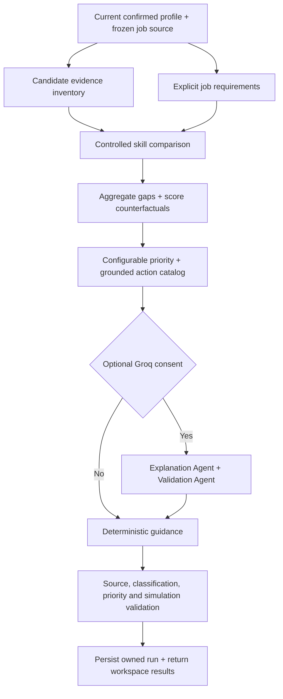

# Skill Gap Analysis and Career Guidance

This milestone extends the existing Career Orchestrator, confirmed-profile boundary, seeded job provider, matcher, owned API/session model and dashboard. Inspection was limited to these integration points. Prior resume processing, the 10,000-job fixture, matching formulas, location/role fixes and existing history were preserved; the repositories were not re-audited.

## Workflow and actual agent execution

`SkillGapFlow` is a genuine `crewai.Flow`, with typed state, decorated dependency stages, immutable input snapshots, per-stage execution IDs, checkpoints, a deadline and atomic database publication. Evidence normalization/comparison/priority tasks execute locally and deterministically. When explicitly selected, **two actual `crewai.Agent` objects in a sequential `crewai.Crew`** perform guidance selection and independent validation through Groq. We do not claim that deterministic Flow stages are separate LLM calls. This follows the existing matching architecture and keeps numeric decisions reproducible.

| Stage | Responsibility | Structured inputs → outputs | Failure policy |
|---|---|---|---|
| preparing | Career Orchestrator | Frozen selection/profile → selected schema-valid jobs | No invented jobs or requirements; explicit empty target |
| analysing_profile | Candidate Skill Profile Agent | Confirmed facts/proofs → `InventorySkill[]` | Preserve origin/strength; no proficiency inference |
| analysing_requirements | Job Requirement Analysis Agent | `Job[]` → `Requirement[]` plus context | Mandatory, preferred, optional tools and unknown stay separate |
| comparing_skills | Skill Comparison / Gap Analysis responsibilities | Inventory + requirements → `SkillComparison[]` | Controlled aliases/relationships; conflicts retained |
| prioritising_gaps | Skill Priority / Career Guidance Agent | Comparisons, corpus frequencies, scorer → aggregated `GapRecord[]` | Configurable transparent math, no profile edits |
| generating_guidance | Recommendation Explanation Agent | Grounded gap/action catalog → guidance choices | Actual optional CrewAI agents; retain local results on failure |
| validating | Skill Gap Validation Agent | Sources + outputs → validation summary | Reject unsupported/incomplete/duplicate/contradictory output |

Candidate/job content is untrusted data, never instructions. Optional agents have no tools, delegation, code execution, memory, planning or authority to change facts. Each agent has one bounded model call. JSON schemas and ID allowlists prevent new skills, certificates, scores, priorities, courses or employment claims from entering results. All highlighted guidance comes from stored grounded actions. Conflicting agent proposals and review issues remain in provider metadata/conflicts; they are not silently applied.

## Sources and supported analysis modes

- **single:** exactly one selected job from the fixture or an owned matching run.
- **selected:** 1–30 explicitly selected jobs; duplicate IDs rejected, duplicate business signatures excluded before aggregation.
- **top_ranked:** top 1–30 persisted recommendations above that source run's saved threshold. The source is an owned completed/partial run; default is the latest completed/partial run.
- **target:** existing role/category/location/work-mode/date filters over the provider, followed by existing local hybrid scoring and a top-1–30 sample. Candidate-specific raw scores are used for selecting the sample. Exact target wording may have no fixture coverage; an empty source produces no invented role requirements.

Role targeting is a current analysis instruction, not a new confirmed candidate preference. All modes use **current confirmed profile facts**, not a resume draft or an old matching candidate snapshot. Old job recommendations remain frozen inputs, with source-run revision/score metadata. The broader frequency denominator is the whole deduplicated fixture (9,990 records across all dates); selected-job frequencies use only analysed jobs. Target selection reports its eligible/sample counts and filter trace. This is a sample-based career view, not an exhaustive claim about a role or live labour market.

Fields used: original skills, projects, experience, education, certifications, objective, preferred roles/locations, home location and career level. Identity, email, phone, links and unconfirmed extraction fields are excluded. Matching snapshots already have project/work technology evidence; confirmation receipts supply available confidence/source proof. Manually confirmed facts can have unknown source confidence. Frozen proof metadata describes the run's historical sources rather than a live document-availability guarantee.

Incomplete but useful confirmed profiles can run. Missing skill evidence yields **unknown**, not proof that a skill is absent. A missing/unconfirmed profile cannot run. Name/contact alone cannot establish a skill inventory. No confirmation endpoint is called by this workflow.

## Taxonomy, evidence and classifications

The shared conservative skill taxonomy supplies exact/synonym equivalence, controlled related pairs and directional transferable foundations. Existing JS, TS, React.js, Node, Postgres, ML, NLP and AWS aliases are reused. A skill-only AI ↔ Artificial Intelligence alias was added without rewriting the frozen lexical index or fixture. There is no fuzzy matching or embedding-based skill equivalence.

The new taxonomy groups languages, frontend, backend, databases, analytics, ML, AI, NLP, vision, cloud, DevOps, security, testing, networking, embedded systems, design, project management, communication, research, tools, frameworks, libraries and platforms. Unknown labels remain domain skills. This is a small curated registry, not a claim to cover every technology. Narrative phrase detection uses term boundaries and longest matches so ML is not extracted from HTML and Java is not extracted from JavaScript.

Evidence contains original term, normalized term, confirmed field path, origin, strength, available source proof/confidence and any explicit denial. Distinctions:

| Evidence | Interpretation / comparison |
|---|---|
| Direct skill list | Explicitly confirmed skill claim; exact/synonym `confirmed_match` |
| Structured project/work technology | Supported usage, `partial_match`; existing matcher grants technology-field credit, but proficiency remains unestablished |
| Narrative project/work mention | `inferred` evidence; partial weak association, no automatic requirement credit |
| Certification title mention | Supported by a confirmed certification field, not independently validated certification/proficiency; requires review |
| Objective-only mention | Interest/mention only; `unknown` skill ability, no requirement credit |
| Controlled related technology | Related/partial or strong related concept; never exact requirement credit |
| Directional foundation | `transferable_match`; e.g. SQL may help with PostgreSQL, without claiming PostgreSQL proficiency |
| No equivalent evidence, other skills known | `missing` means missing evidence, explicitly not proof of inability |
| No useful skill inventory / unknown requirements | `unknown` |
| Explicit denial | `explicitly_mismatched`; conflicting positive/negative evidence yields unknown + needs_review |

The schema also supports `not_applicable` without using it to disguise unknown requirements. Unrequested candidate skills remain in the inventory; they are not turned into fabricated job requirements or penalized. No numerical proficiency level is generated.

Only explicit `required_skills` are mandatory/critical under the existing matcher's policy. Preferred entries stay preferred. Other `tools_and_technologies` are optional supporting tools. Required/preferred duplicate aliases are counted once with explicit-required precedence and a warning. If required/preferred fields are empty, an unknown-requirements record is retained even when optional tools exist. Descriptions and responsibilities remain frozen context rather than a source for invented mandatory requirements. Education, professional years, location and work mode stay visible as eligibility context and in scorer components.

## Aggregation and priority

One canonical gap per skill aggregates affected job IDs, original wording, classifications, candidate/related evidence, required/preferred/optional counts, corpus required/preferred counts, temporary match impacts and review status. Directly confirmed matches do not become gaps. Project/work evidence-only matches remain evidence-strength review gaps and can have **zero score impact**, because the existing matcher already credits that explicit technology evidence.

Default priority is `100 × sum(feature × weight)`; components and contributions are stored for every gap:

| Feature | Weight | Definition |
|---|---:|---|
| mandatory | .24 | 1 when at least one selected job explicitly requires it |
| selected_frequency | .20 | affected jobs / analysed jobs |
| corpus_frequency | .08 | deduplicated fixture required + preferred count / corpus size, capped at 1 |
| role_centrality | .12 | selected required count / affected count; a transparent empirical proxy |
| proximity | .08 | .25 without support, .75 with a mention, 1 with a controlled related foundation |
| simulated_impact | .12 | mean counterfactual raw-point change / 100, clipped to 0–1 |
| foundation | .10 | curated foundational vocabulary, otherwise 0 |
| effort | .06 | .75 for tools/frameworks/libraries, .5 otherwise; an explicit heuristic, not a time promise |

Levels: Critical ≥75 with required evidence; High ≥55; Medium ≥30; Low otherwise. Unknown requirements are always Low. Preferred/optional requirements cannot become Critical. Rare one-off skills have low selected frequency; a single unusual listing does not automatically determine career guidance. Weights are configurable in `SKILL_GAP_PRIORITY_WEIGHTS` and validated to sum to one. These priority values are learning-review heuristics, not probabilities or proven learning-effort predictions.

Every gap has a priority reason and a review-first action. General learning guidance suggests an assessable exercise and honest evidence collection, not a completed course/certification. Experience-dependent wording is flagged; actual minimum professional years and education are shown separately. No exact learning duration is fabricated.

## Match-impact simulation

Current scores are recomputed with the existing `normalize_candidate`, `normalize_job`, `TfidfBaseline` and `score_job` against the analysed corpus. Saved source-run scores are exposed separately, since profile/corpus/provider differences can change scores. The simulation deep-copies facts and adds one hypothetical skill to that temporary copy. TF-IDF, project and interest text features stay fixed; required/preferred overlap, effective weights, uncertainty ceiling and critical penalty are recomputed by the existing scorer.

For every affected job the result stores current raw score, simulated raw score, delta, source saved score when available, confidence and method. Average impact is over affected jobs. All scores use **0–100 raw points**; no hiring probability or calibrated future percentage is projected. Optional tools may have zero impact. Adding a first known skill can change available weights, so improvement is not guaranteed. Location, education or experience gaps cannot be erased by a skill simulation. Real profile updates still require the existing review/confirmation workflow and genuine evidence.

## Persistence, API and failure handling

Two additive tables:

- `skill_gap_runs`: owner and active lease, profile revision/fingerprint, request/config, frozen candidate and job snapshots, selection metadata, typed nested inventory/requirements/comparisons/gaps/priority/impact/guidance/validation/conflicts, task/provider trace and timestamps.
- `skill_gap_reviews`: unique run/gap annotations (`reviewed`, `dismissed`, `needs_review`, optional note). These do not mutate facts, remove historical evidence or silently clear agent conflicts.

Nested typed JSON follows the existing resume/matching snapshot architecture rather than introducing redundant tables for every nested field. `python -m app.db.migrate` and startup perform idempotent additive table creation. Existing columns, IDs, profiles, receipts, documents, matching results and the fixture are preserved. A private backup precedes local main-database migration. Historical private snapshots follow existing workspace retention behavior; account deletion/retention policy remains future work.

| API | Contract |
|---|---|
| GET `/api/v1/skill-gaps/readiness` | Confirmed-data readiness; missing evidence remains unknown |
| POST `/skill-gaps/runs` | `GapStart`; returns 202 `GapRunResponse` |
| GET `/skill-gaps/runs` | Latest 20 owned run summaries |
| GET `/skill-gaps/runs/{id}` | Status, task trace, provider/config metadata, timestamp and staleness |
| GET `/skill-gaps/runs/{id}/results` | Priority filter, page ≥1, page size 1–100; inventories, gaps, analysed jobs, reviews and validation |
| GET `/skill-gaps/runs/{id}/gaps/{gap_id}` | Requirement/candidate evidence and priority/impact calculations |
| GET `/skill-gaps/runs/{id}/audit` | Frozen analysed sources, comparisons, selection/frequency math and validation |
| PUT `/skill-gaps/runs/{id}/gaps/{gap_id}/review` | Annotate a gap decision/note; never confirm a new skill |
| POST `/skill-gaps/runs/{id}/retry` | New run using current confirmed facts and saved selection instruction |
| POST `/skill-gaps/runs/{id}/cancel` | Atomically cancel active run and prevent late publication |

All `/skill-gaps/...` paths above use the `/api/v1` prefix, existing private session/local-client headers, and ownership checks. Other users receive 404 for private run/evidence/review paths. Explicit job IDs are verified against the selected source; duplicate job IDs are rejected. Maximum selected/analysed job count is 30. Target candidate pools respect existing filter/max-results bounds.

The existing bounded subprocess/key-lease/checkpoint infrastructure is reused. There are two local worker threads, queue capacity four, one active analysis per user and a configurable 120-second deadline. Cancellation is polled at stage boundaries and prevents late publication even while the child is working. Startup marks interrupted active runs failed/retryable. Optional provider/model timeout or invalid output retains a validated deterministic checkpoint as partial. Structural/source validation failure publishes no untrusted results. Agent disagreement or positive/negative candidate conflict is needs_review with the conflict retained.

`GROQ_API_KEY_1/2/3` and the existing shared manager handle rotation, quota/429, retryable server/network failures, cooldown and lease cleanup. No keys enter frontend, reports, payloads or logs. Optional export is the skill/requirement/action catalog without resume excerpts, identity or project/employer names. The source skill names themselves are candidate data; the UI explicitly requests consent. Local analysis works without keys or an embedding model.

## Workspace

`/skill-gaps` now replaces its planned placeholder. Recommendation cards link to one-job analysis. Users can choose one or multiple recommendations across picker pages, top-ranked jobs, or a role/category/location/work-mode target. The dashboard reports the latest non-stale analysis gap count. The current dark/rose interface, shared panels, focus behavior, native details, mobile navigation and error/loading patterns are reused; the landing-page illustrative preview remains separate.

The main view separates confirmed skills and supporting mentions, then lists priority gaps, requirement type, affected counts and estimated average raw-point changes. Expand a gap for wordings, source paths, missing/related evidence, affected jobs, exact priority components, score simulations and review decisions. Expand the run audit for technical snapshots and actual task/provider execution. Loading, empty target, incomplete/unconfirmed profile, backend error, cancelled, failed, partial, needs_review and stale states are explicit.

Summary export downloads **the current filtered result page only**, labelled as such; it is not a full learning-progress record. No automatic application, course enrolment, generated certification or employment guarantee is included.

## Validation and remaining limits

Synthetic fixtures cover backend, frontend, AI, cybersecurity, cloud/multi-job, misleading substring overlap, incomplete metadata and explicit denials/conflicts. They contain no private resumes. Machine-readable results:

- [Authored fixture evaluation](skill-gap-evaluation.json): 9 candidate/target scenarios, **32/32 classification checks**, required/preferred/optional classification accuracy **1.0**, unsupported-claim rate **0**, duplicate-gap rate **0**. Eight credited matches have source evidence; 22 gap explanations pass reference/count grounding checks. Priority consistency is **1.0** across repeats and one authored frequency-order judgment. Mean warm Flow latency was **0.0174 s**, max **0.0688 s**; these exclude subprocess/HTTP/model startup.
- [API/subprocess smoke](skill-gap-api-smoke.json): single job **1 job / 7 gaps**, selected **2 / 7**, top-ranked **2 / 8**, AI/Bengaluru/onsite target **3 / 5**, Atlantis target **0 / 0**, and deliberate no-key optional review **partial, 1 / 7**. All source/score validation checks passed and the profile stayed byte-for-byte unchanged. Real spawned-worker latency ranged **2.124–3.1401 s** in this sample.
- [Actual Groq Crew smoke](skill-gap-live-smoke.json): **completed**, model `openai/gpt-oss-120b`, both real agents completed, **4 synthetic gaps**, no conflicts, **4.4268 s** through the full isolated worker and all seven Flow stages. No private profile or resume was loaded. Three-key rotation was separately verified with controlled 429/503 failures; live quotas were not deliberately exhausted.
- [Main-workspace smoke](skill-gap-main-smoke.json): existing confirmed profile, top **10** recommendations, **14** evidence gaps (**2 High, 7 Medium, 5 Low**), all seven stages completed, unsupported claims **0**, **3.878 s**. No private data was exported.
- [Main database preservation](skill-gap-database-preservation.json): every pre-existing row unchanged; only the two skill-gap tables were added/populated. A backup was created before migration.

The evaluation's perfect rates apply only to the small authored fixtures. Explanation accuracy here checks grounding/counts, not human-rated educational quality. The controlled fallback frequency is **1.0 under deliberate no-key failure**, not an estimate of production outages. The taxonomy is not trained/evaluated against a broad real-resume benchmark.

New regression coverage includes **43 backend cases** for source distinctions, aliases, required/preferred/optional separation, incomplete jobs/profiles, multi-job frequency, priority math, impact simulation, conflicts, unsupported output rejection, real CrewAI tasks, three-key rotation, malformed output, provider failure, ownership, review, retry, cancellation, stale detection, additive migrations and a real spawned pipeline. Five new browser scenarios exercise profile prerequisites/errors, role targeting/evidence/export/mobile layout, recommendation links and all selection modes, optional-provider partial/retry, empty targets and cancellation. The complete final browser suite passed **41 tests**, including the first-load hydration guard. All five skill-gap scenarios passed again after adding an explicit assertion that failed optional guidance has a partial task trace. Readable desktop/mobile captures were inspected with synthetic data; no browser errors or horizontal overflow were observed.

| Final check | Actual result |
|---|---|
| Full backend suite, native macOS execution | **376 passed**, 392 dependency warnings, **185.12 s** |
| Full Chromium browser suite | **41 passed**, approximately **2.9 minutes** |
| Frontend TypeScript | Passed |
| Frontend ESLint | **0 errors**, 10 existing Fast Refresh warnings |
| Production build | Passed |
| Python compilation / both repository whitespace checks | Passed |
| Existing 10,000-job fixture validation | Passed, original SHA preserved |
| Additive migration | Repeated initialization preserved all existing rows; only skill-gap tables added |
| API/subprocess, synthetic evaluation and actual Groq Crew | Passed; artifacts linked above |
| Main application | `/skill-gaps` and `/matches` on port 5173 and backend health on 8000 return HTTP 200; new API paths registered |
| Public artifact privacy scan | No private identity/contact values or provider credential patterns |

Native macOS access is necessary for the existing LibreOffice application-launch regression. A sandboxed full run passed 375 tests with that conversion check failing; the native conversion recheck passed unchanged. A subsequent concurrent native run exposed one transient existing resume-fallback failure; its 12-test module passed unchanged in isolation. The final serialized native suite passed all **376**. No unrelated resume/converter implementation or test expectations were altered to obtain that result. No standalone backend lint tool is configured; backend verification used compilation, the full tests and pipeline evaluations.

See [consolidated verification](skill-gap-verification.json) for the final machine-readable result. Existing historical milestone reports are intentionally retained.

Known limits: the curated taxonomy/relationship graph is conservative and incomplete; narrative mentions are not proof of applied expertise; optional review selects existing actions rather than writing a full curriculum; top-k role analysis is sample-biased; learning effort is a documented heuristic; priority weights need human-labelled evaluation; fixed-text local score simulations omit semantic/text changes and do not predict employment. No model downloads or live job-provider integration were added. Browser validation here uses Chromium.

Recommended next milestone: reviewed learning-resource suggestions mapped to these gap IDs and explicit prerequisites, with user-controlled progress evidence. Resource verification, enrolment, applications and external writes need their own future implementation; this milestone performs none automatically.
